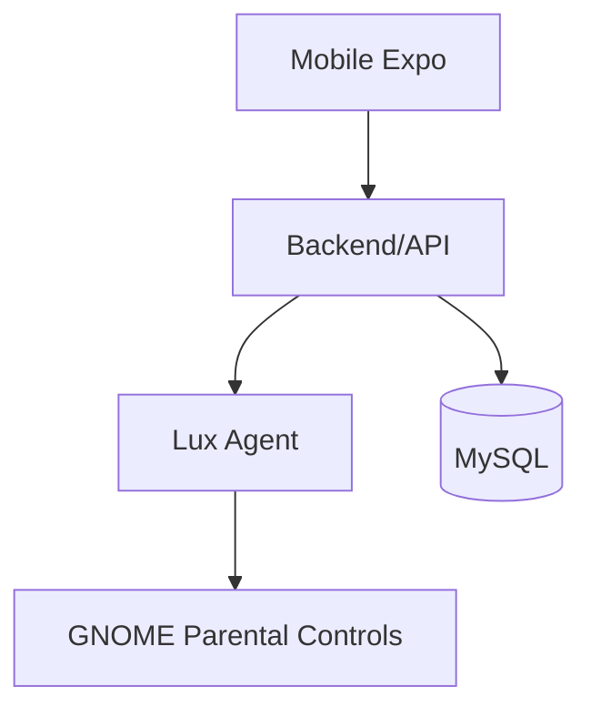

# Arquitetura

## Confirmado

O mobile apresenta dados e ações. O backend acessa MySQL e intermedeia a comunicação com o Lux. O Agent integra as operações permitidas pelo GNOME e pela autorização do Linux. O GNOME aplica o controle parental. O celular não acessa o computador diretamente por IP local e não acessa MySQL.

## Desenvolvimento com mock

Há duas fronteiras possíveis de simulação:

| Cenário | Fluxo | O que o mock substitui |
| --- | --- | --- |
| Atual, sem backend | Mobile → serviço mock dentro do app | Respostas que o mobile receberia do backend, sem depender do backend ou do Lux |
| Futuro, com backend | Mobile → Backend → Mock do Lux Agent | Operações oferecidas pelo Agent, como consultar configurações e retornar resultados de alterações simuladas |

O mock do Lux Agent permitirá desenvolver e testar o backend sem um computador Lux disponível. Ele deverá respeitar o mesmo contrato usado com o Agent real, para que a integração possa ser substituída sem mudar o mobile. Esse contrato ainda será definido; o mock do Agent não está implementado nesta entrega.

Uma alteração aceita pelo mock é um resultado simulado, não evidência de que o GNOME oferece ou aplicou aquela operação. As capacidades reais continuam sujeitas à investigação descrita em [integração Lux](lux-integration.md).

Uma feature consome um contrato assíncrono independente da origem dos dados. A exportação `devices` atualmente seleciona `mockDevices`; uma implementação HTTP futura deve cumprir `DevicesSource` e substituir essa seleção, preservando os consumidores. Sem provider, store global ou servidor de mocks.

O único contrato inicial é a listagem de computadores com `id` e `name`. É provisório e interno ao mobile; não define endpoints ou modelo de persistência. As telas existentes ainda não o consomem para respeitar a preservação solicitada.

## Provisório / TBD

Tecnologias do backend e Agent, protocolo Backend ↔ Agent, conexão iniciada pelo Agent ou outra solução de alcance remoto, autenticação, entrega de comandos e confirmação de aplicação. As setas representam responsabilidades, não um protocolo implementado nem conectividade inbound disponível no Lux.
