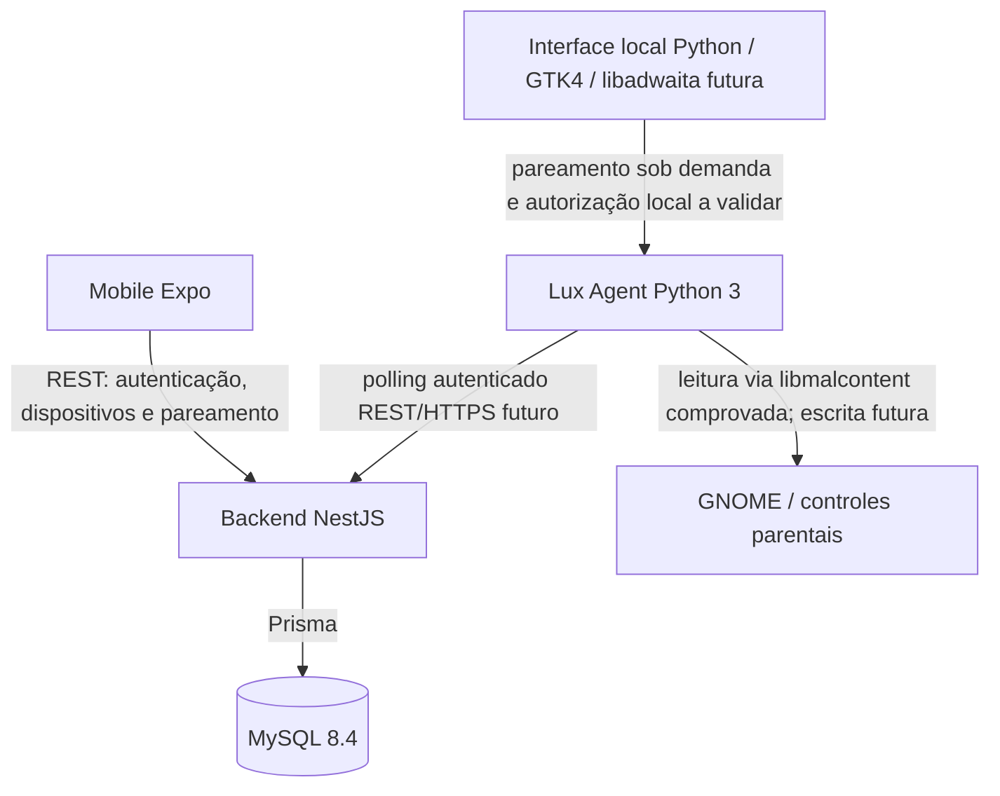

# Arquitetura

## Componentes e responsabilidades

O mobile é um cliente remoto e conversa somente com a API; não acessa MySQL nem o computador Lux diretamente. O backend é um monólito modular em TypeScript/Node.js LTS com NestJS, REST e Prisma. Ele disponibiliza a API, persiste dados e intermedeia operações com agentes. O agente Python 3 será instalado como serviço systemd, iniciará comunicação com o backend por polling e integrará operações locais permitidas pelo sistema, reportando resultados. O GNOME/Lux aplica as restrições. A interface gráfica local de pareamento será um aplicativo Python/GTK4/libadwaita distinto do serviço, aberto sob demanda por um administrador. Fechá-la não interrompe o Agent. Ambos serão instalados no Lux; estarem neste repositório não implica execução no servidor ou celular.

O backend persiste responsáveis, dispositivos e contratos de pareamento em MySQL; autentica responsáveis com Argon2id e JWT de 30 minutos, e computadores com credenciais individuais provisionadas administrativamente. O mobile usa login, consulta de perfil e listagem reais, armazena a sessão em SecureStore no Android/iOS e protege a navegação. A listagem filtra pelo responsável autenticado e distingue vínculo ativo de fixtures legadas; nenhum registro comprova integração Linux. As fixtures são identificadas como demonstração e a conexão permanece não validada. Existe uma PoC local de leitura libmalcontent em `lux-agent/`; a comunicação agente-backend e a aplicação de políticas pelo agente são futuras. O agente iniciará a comunicação por REST/HTTPS (polling); conectividade de entrada no computador não é requisito assumido. Os contratos de identidade e pareamento estão definidos nesta etapa; confirmação de aplicação parental ainda depende de investigação e validação no Lux real.

## Etapas de implementação

Estado baseado na implementação existente. “Implementada” descreve o código existente, sem implicar validação em todos os ambientes. Os critérios de conclusão das etapas parciais/planejadas continuam pendentes.

| Etapa | Estado | Evidência atual e trabalho restante |
| --- | --- | --- |
| 1. Fundação NestJS, Prisma, MySQL e Docker | Implementada | Scaffold modular, conexão/saúde, três migrations e Compose com watch. Execução no host prevista pelos mesmos scripts/configuração; limites da validação em [README](../README.md#limites-de-validação-dos-fluxos). |
| 2. Autenticação, dispositivos e integração mobile | Parcial | Login/perfil JWT, listagem autorizada e revogação integrados. Contas vêm de seed; computadores de seed ou provisionamento administrativo. Não há cadastro público, edição geral de dispositivos nem presença real. |
| 3. Infraestrutura de pareamento seguro | Implementada na API/mobile | Identidade individual, token de cinco minutos/uso único, consumo transacional, leitura/confirmação de QR e revogação. Autorização local e pareamento com Agent físico pendentes. |
| 4. Prova de conceito Python/malcontent no Lux | Leitura validada com e sem restrições | VM Lux 3/Canopus, GNOME 50.4, malcontent 0.13.1-5. Própria conta consultada sem sudo; leitura restritiva de outra conta exigiu sudo autenticado pelo usuário. JSONs antes/depois idênticos e campos expostos pela CLI compatíveis; testes no WSL2 e Lux. Privilégios mínimos do futuro serviço pendentes; ver [registro](lux-integration.md#registro-de-provas-técnicas). |
| 5. Lux Agent mínimo | Planejada | Implementar identidade instalada, HTTPS de saída, polling, pareamento inicialmente com QR no terminal, recuperação de conexão e instalação systemd. Contratos de pareamento da API já existem. |
| 6. Interface GTK4/libadwaita | Planejada | Aplicativo Python independente para autorização e QR temporário; definir comunicação local com Agent e validar permissões. |
| 7. Controle parental nativo real | Planejada | Implementar somente operações demonstradas na prova técnica, incluindo consulta posterior do resultado; backend deverá registrar comandos/resultados. |
| 8. Validação ponta a ponta e expansão | Planejada | Validar mobile → API → Agent → GNOME, falhas, revogação e aplicação confirmada; expandir capacidades gradualmente. |

A investigação GNOME pode avançar na VM disponível. O foco acadêmico principal permanece no mobile; mocks identificados e contratos explícitos permitem seu desenvolvimento sem bloquear pela integração Linux. Etapas do roadmap não equivalem a entregas executadas.

## Fluxo esperado de operações parentais

Este fluxo é planejado; não existem modelos, endpoints ou processamento de comandos parentais no código atual.

1. O responsável solicita a alteração pelo mobile via HTTPS/REST.
2. NestJS autentica, autoriza o recurso e registra o comando pendente em MySQL por Prisma.
3. O Agent do computador inicia polling autenticado por HTTPS/REST e recebe trabalho autorizado. O servidor não precisa iniciar conexão de entrada no Lux.
4. O Agent executa somente a operação local suportada por libmalcontent/D-Bus e serviços GNOME, respeitando permissões, e consulta se a alteração foi aplicada.
5. O Agent informa sucesso confirmado, falha ou indisponibilidade; o backend registra o resultado e o mobile o consulta.

Comando recebido ou pendente não pode aparecer como concluído. O mobile só indicará configuração efetivamente aplicada após confirmação apropriada do Agent. Estados, repetição segura, recuperação após desconexão e comportamento offline precisam de contrato antes da implementação. D-Bus comunica processos locais; systemd mantém o serviço em execução. O Agent não cria outro mecanismo parental nem aceita execução arbitrária de comandos.

## Mocks e contratos

Há duas fronteiras de simulação:

| Cenário | Fluxo | O que o mock substitui |
| --- | --- | --- |
| Utilitário demonstrativo preservado, fora do fluxo atual | `pairingDemo` no mobile → mock em memória | Simulação local de pareamento, sem modificar a API ou conectar ao Lux |
| Futuro, com API integrada | Mobile → Backend → mock do Lux Agent | Operações expostas pelo agente, permitindo desenvolver backend sem computador Lux |

`devices.listPairedComputers(): Promise<PairedComputer[]>` usa `GET /devices`, sem fallback para mock. A resposta traz `id`, `name`, `managedUser` opcional, `status: "unverified"`, `lastSeen: null`, `isDemo`, `paired` e `associationId` quando pareado. O nome histórico do método não implica pareamento validado. Home e Computadores consomem o serviço HTTP da feature; autenticação e erros passam pelo cliente compartilhado. Os seeds podem criar fixtures persistidas com `isDemo: true`, mas não simulam um agente online.

`pairingDemo.simulatePairing()` permanece como utilitário de mock, separado do fluxo HTTP. A tela de pareamento usa a API para validar e consumir o QR; os mocks existentes e placeholders parentais são preservados. Uma fixture de identidade/pareamento deve permanecer demonstrativa, inclusive na confirmação mobile, e não comprova conexão a um Lux.

No cenário futuro, o mock do agente deverá cumprir o mesmo contrato do agente real. Esse mock ainda não foi implementado. Uma resposta simulada não confirma suporte nem aplicação da operação no GNOME.

## Fronteiras do pareamento

O MVP permite um responsável ativo por computador. A identidade do Agent é provisionada administrativamente antes do pareamento: uma credencial aleatória individual é instalada por um administrador local, e somente seu hash fica no backend. Não há registro público que transforme um `deviceId` em identidade confiável. O procedimento e suas limitações estão em [Integração Lux](lux-integration.md).

O Agent previamente autorizado deve verificar a autorização administrativa local antes de solicitar uma sessão. O backend autentica o Agent, mas não consegue comprovar sozinho a autorização Linux; essa obrigação depende da implementação e validação do Agent real. O QR contém apenas um token temporário, separado da identidade do Agent. O responsável autenticado valida o token, confirma o computador e solicita o consumo. Consumo e criação do vínculo ocorrem na mesma transação, serializados por computador, impedindo uso concorrente e dois responsáveis ativos.

A revogação remove o acesso do responsável na API e invalida sessões pendentes do computador. Para associar novamente, é necessária outra sessão criada após autorização local. O Agent só pode consultar ou revogar vínculos do próprio computador. A revogação no backend não demonstra remoção de restrições Linux; o efeito local ainda depende do Agent e da investigação GNOME.

Fixtures e identidades de desenvolvimento devem permanecer identificadas como demonstração e não podem ser aceitas como agentes em produção. Mesmo uma associação real na API não comprova presença online nem integração Linux. HTTPS é obrigatório fora do desenvolvimento local; não se transmite credencial administrativa Linux.

## Limites técnicos do Lux

O ambiente disponível é uma VM VirtualBox com Lux 3/Canopus (Debian Trixie), GNOME 50.4, malcontent 0.13.1-5 e AccountsService ativo. A leitura via Python/PyGObject/libmalcontent está comprovada em contas com e sem restrições, com autenticação administrativa para consultar outra conta. O usuário relatou configuração nativa de horários, bloqueio de login via PAM/GDM e restrições observadas no GNOME; isso não implementa escrita pelo Agent nem comprova encerramento automático ou bloqueio de execução direta. `libpam-malcontent` precisou de instalação manual. A avaliação de horários UTC foi verificada em memória; aplicação efetiva nas fronteiras do dia, privilégios mínimos e autorização do futuro serviço ainda exigem validação. Ver [integração Lux](lux-integration.md) para evidências e limites.
