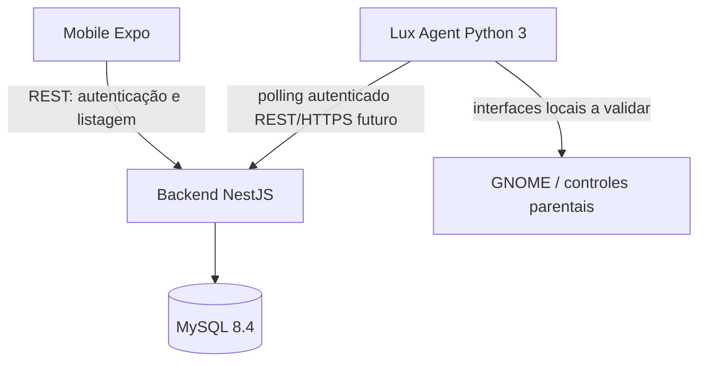

# Arquitetura

## Componentes e responsabilidades

O mobile é um cliente remoto e conversa somente com a API; não acessa MySQL nem o computador Lux diretamente. O backend é um monólito modular em TypeScript/Node.js LTS com NestJS, REST e Prisma. Ele disponibiliza a API, persiste dados e intermedeia operações com agentes. O agente Python 3 será instalado como serviço systemd, iniciará comunicação com o backend por polling e integrará operações locais permitidas pelo sistema, reportando resultados. O GNOME/Lux aplica as restrições.

O backend persiste responsáveis e registros de dispositivos em MySQL e autentica com Argon2id e JWT de 30 minutos. O mobile usa login, consulta de perfil e listagem reais, armazena a sessão em SecureStore no Android/iOS e protege a navegação. A listagem filtra pelo responsável autenticado; a associação de banco não comprova pareamento. As fixtures são identificadas como demonstração e a conexão permanece não validada. A comunicação agente-backend e a integração do agente com o GNOME são futuras. O agente iniciará a comunicação por REST/HTTPS (polling); conectividade de entrada no computador não é requisito assumido. Protocolo, autenticação e confirmação de aplicação serão definidos e validados antes do uso real.

## Etapas de implementação

1. Fundação concluída: aplicativo mobile demonstrativo com mocks, backend NestJS executável com Prisma, Docker/MySQL e documentação.
2. Backend/mobile desta etapa concluídos: autenticação real e listagem autorizada de registros de dispositivos integradas ao mobile. Responsáveis e fixtures são criados por seeds explícitos de desenvolvimento; não há cadastro público nem criação de dispositivos pela API.
3. Pareamento: fluxo seguro para vincular um computador e seu agente a uma conta responsável.
4. Prova técnica GNOME: investigar e implementar o mínimo do agente quando o ambiente Lux estiver disponível. Essa investigação pode ocorrer em paralelo com as etapas 2 e 3, mas não deve ser tratada como capacidade confirmada.
5. Operação ponta a ponta: validar autenticação, pareamento, disponibilidade, consulta e aplicação real no Lenovo Lux, documentando limites observados.

## Mocks e contratos

Há duas fronteiras de simulação:

| Cenário | Fluxo | O que o mock substitui |
| --- | --- | --- |
| Pareamento demonstrativo | Mobile → serviço mock no app | Simulação local de pareamento, sem modificar a API ou conectar ao Lux |
| Futuro, com API integrada | Mobile → Backend → mock do Lux Agent | Operações expostas pelo agente, permitindo desenvolver backend sem computador Lux |

`devices.listPairedComputers(): Promise<PairedComputer[]>` usa `GET /devices`, sem fallback para mock. A resposta traz `id`, `name`, `managedUser` opcional, `status: "unverified"`, `lastSeen: null` e `isDemo`. O nome histórico do método não implica pareamento validado. Home e Computadores consomem o serviço HTTP da feature; autenticação e erros passam pelo cliente compartilhado. Os seeds podem criar fixtures persistidas com `isDemo: true`, mas não simulam um agente online.

`pairingDemo.simulatePairing()` acrescenta um quarto computador fictício ao mock, idempotentemente, somente em memória até o processo do app reiniciar. A confirmação exibe esse exemplo; a listagem real permanece inalterada. Os mocks existentes e os placeholders parentais foram preservados. O fluxo não ativa câmera, não valida QR nem conecta a um Lux.

No cenário futuro, o mock do agente deverá cumprir o mesmo contrato do agente real. Esse mock ainda não foi implementado. Uma resposta simulada não confirma suporte nem aplicação da operação no GNOME.

## Limites técnicos do Lux

O ambiente informado é GNOME 50.5. Uma ISO do Lenovo Lux não está disponível para reproduzir o ambiente. D-Bus, malcontent/libmalcontent, AccountsService e autorização via polkit são hipóteses de investigação, não interfaces validadas nem uma promessa de API estável. Ver [integração Lux](lux-integration.md) para critérios e registro de evidências.
