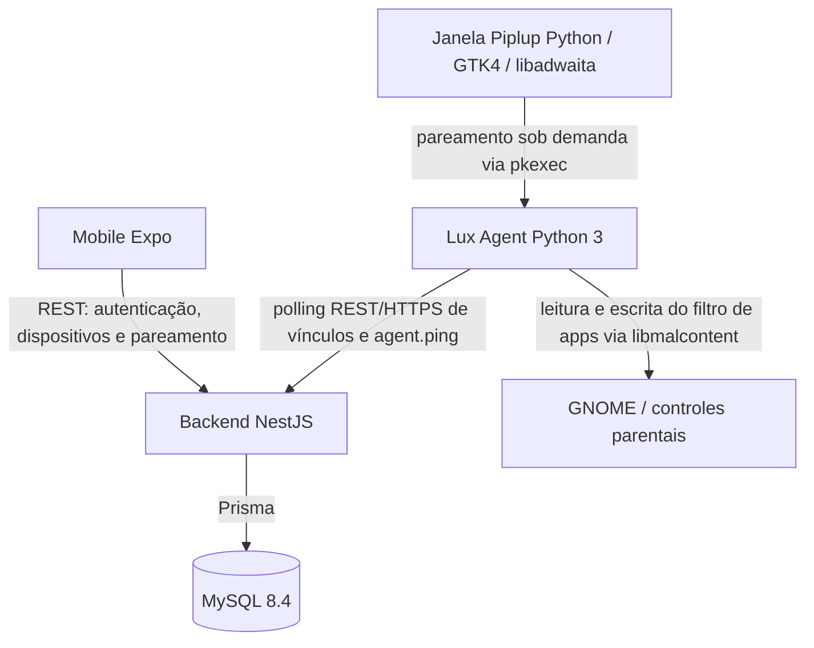

# Arquitetura

## Componentes e responsabilidades

O mobile é um cliente remoto e conversa somente com a API; não acessa MySQL nem o computador Lux diretamente. O backend é um monólito modular em TypeScript/Node.js LTS com NestJS, REST e Prisma. Ele disponibiliza a API, persiste dados e intermedeia operações com agentes. O agente Python 3 roda como serviço systemd, inicia a comunicação com o backend por polling, aplica as operações locais permitidas pelo sistema e reporta os resultados. O GNOME/Lux aplica as restrições. A interface gráfica local de pareamento é um aplicativo Python/GTK4/libadwaita distinto do serviço, aberto sob demanda por um administrador. Fechá-la não interrompe o Agent. Ambos são instalados no Lux; estarem neste repositório não implica execução no servidor ou celular.

O backend persiste responsáveis, dispositivos, inventário, pedidos de instalação, políticas e comandos em MySQL; autentica responsáveis com Argon2id e JWT de 30 minutos, e computadores com credenciais individuais criadas no autorregistro do Agent. O mobile usa a API real para login, listagem, pareamento e configurações, armazena a sessão em SecureStore no Android/iOS e protege a navegação. A listagem filtra pelo responsável autenticado e distingue vínculo ativo de fixtures legadas, identificadas como demonstração. Presença vem do heartbeat do client simulado ou do último contato autenticado do Agent; nenhuma das duas comprova política aplicada. O Agent envia o inventário de aplicativos por `PUT /agent/reports` e executa `agent.ping` e `parental.app_filter.set` com reserva, diário e releitura. A comunicação é sempre iniciada pelo Agent por REST/HTTPS; conectividade de entrada no computador não é requisito. Controles de segurança e limitações estão em [Segurança](security.md).

O código do Agent está no pacote `lux_agent`, com CLI `python3 -m lux_agent` (em `lux-agent/`) e testes separados. Transporte, polling, comandos, diário e leitura malcontent têm módulos próprios; os três scripts antigos são wrappers de compatibilidade. Estrutura, execução e sincronização restrita estão no [README do Agent](../../lux-agent/README.md#organização-e-execução).

## Etapas de implementação

Estado baseado na implementação existente. “Implementada” descreve o código existente, sem implicar validação em todos os ambientes. Os critérios de conclusão das etapas parciais/planejadas continuam pendentes.

| Etapa | Estado | Evidência atual e trabalho restante |
| --- | --- | --- |
| 1. Fundação NestJS, Prisma, MySQL e Docker | Implementada | Scaffold modular, conexão/saúde, migrations, objetos SQL usados pela API e Compose com watch. Limites da validação em [README](../../README.md#limites-de-validação-dos-fluxos). |
| 2. Autenticação, dispositivos e integração mobile | Implementada | Cadastro, login/perfil JWT, alteração de e-mail/senha, recuperação por pergunta de segurança sem revelar contas, limite de tentativas, listagem autorizada, revogação e presença. Computadores reais nascem do autorregistro do Agent; seed, provisionamento administrativo e cadastro demonstrativo ficam para desenvolvimento/teste. Logout e troca/redefinição de senha revogam os JWT emitidos. |
| 3. Infraestrutura de pareamento seguro | Implementada | Identidade individual, token de cinco minutos/uso único, consumo transacional, leitura/confirmação de QR e revogação. Autorregistro e pareamento pelo Agent com autorização local `pkexec` ([Integração Lux](../lux/integration.md#pareamento-pelo-agent)). |
| 4. Prova de conceito Python/malcontent no Lux | Concluída | Leitura com e sem restrições e escrita do filtro de aplicativos via regra polkit para o usuário `lux-agent` ([provas](../lux/integration.md#provas-que-sustentam-as-decisões)). |
| 5. Lux Agent | Implementada e validada no Lux | Serviço systemd instalado por `install.sh`, HTTPS verificado, relatórios, `agent.ping`, diário, reinício e revogação ([instalação](../../lux-agent/README.md#instalar-como-serviço), [contrato](../lux/agent-protocol.md)). Pareamento por QR no terminal (`lux-agent pair`) com autorização administrativa local. |
| 6. Interface GTK4/libadwaita | Implementada e validada no Lux | App Piplup que exibe o QR em janela, reutilizando o auxiliar de pareamento via `pkexec` ([interface](../lux/integration.md#interface-gráfica-local-de-pareamento)). |
| 7. Controle parental nativo real | Implementada para apps, navegadores e instalação | As configurações de um computador real geram `parental.app_filter.set`, que o Agent aplica e confirma por releitura; o backend reconcilia o resultado ([contrato](../lux/agent-protocol.md#comandos-parentais-contrato)) e o mobile mostra pendente/aplicado/falha ([Mobile](../mobile/app.md#computador-real)). Ligado por `ENABLE_PARENTAL_COMMANDS`. Horário e classificação etária reais são opcionais (não implementados); o efeito do bloqueio de instalação ainda não foi observado no Lux. |
| 8. Validação ponta a ponta | Planejada | Fluxo completo do zero no Lux real, falhas ensaiadas e roteiro da demonstração; resultado registrado em [Validação](../testing/validation.md). |

O foco acadêmico principal permanece no mobile; o [client simulado](../simulated/client.md) é o plano B da demonstração quando o Lux não estiver disponível.

## Fluxo esperado de operações parentais

O [protocolo do Agent](../lux/agent-protocol.md) implementa `agent.ping` e os [comandos parentais](../lux/agent-protocol.md#comandos-parentais-contrato) de ponta a ponta: o Agent grava o filtro de aplicativos via malcontent e confirma por releitura.

**Estado desejado convertido em comando.** O responsável não cria o comando parental. Ele edita as configurações do computador (`settings` + `revision`), o mesmo contrato do [client simulado](../simulated/client.md). Para computador real, cada nova revision grava o filtro derivado e cria `parental.app_filter.set` com o filtro completo, cancelando os pendentes anteriores. Computador simulado nunca gera comando: continua confirmado pelo próprio client.

1. O responsável solicita a alteração pelo mobile via HTTPS/REST.
2. NestJS autentica, autoriza o recurso e registra o comando pendente em MySQL por Prisma.
3. O Agent do computador inicia polling autenticado por HTTPS/REST e recebe trabalho autorizado. O servidor não precisa iniciar conexão de entrada no Lux.
4. O Agent executa somente a operação local suportada por libmalcontent/D-Bus e serviços GNOME, respeitando permissões, e consulta se a alteração foi aplicada.
5. O Agent informa sucesso confirmado, falha ou indisponibilidade; o backend registra o resultado e o mobile o consulta.

Comando recebido ou pendente não pode aparecer como concluído. O mobile só indica configuração aplicada após confirmação do Agent; estados, repetição e recuperação estão no [protocolo](../lux/agent-protocol.md). D-Bus comunica processos locais; systemd mantém o serviço em execução. O Agent não cria outro mecanismo parental nem aceita execução arbitrária de comandos.

## Mocks e contratos

Há duas fronteiras de simulação:

| Cenário | Fluxo | O que o mock substitui |
| --- | --- | --- |
| Utilitário demonstrativo preservado, fora do fluxo atual | `pairingDemo` no mobile → mock em memória | Simulação local de pareamento, sem modificar a API ou conectar ao Lux |
| Implementado, com API integrada | Mobile → Backend → `simulated-client/` | Cadastro demonstrativo, pareamento, configurações, inventário e decisões de instalação, sem aplicar políticas no sistema operacional |

`devices.listPairedComputers(): Promise<PairedComputer[]>` usa `GET /devices`, sem fallback para mock. A resposta traz `id`, `name`, `managedUser` opcional, `status` (`unverified`/`online`/`offline`), `lastSeen`, `isDemo`, `paired` e `associationId` quando pareado. O nome histórico do método não implica pareamento validado. Home e Computadores consomem o serviço HTTP da feature; autenticação e erros passam pelo cliente compartilhado. Os seeds podem criar fixtures persistidas com `isDemo: true`, mas não simulam um agente online. Presença real vem do último contato autenticado do Agent ([backend](../backend/api.md#presença-do-agent-real)) e não implica política aplicada.

A tela de pareamento usa a API para validar e consumir o QR, sem mock nem fallback. Uma fixture de identidade/pareamento deve permanecer demonstrativa, inclusive na confirmação mobile, e não comprova conexão a um Lux.

O client demonstrativo reutiliza a identidade e o pareamento existentes, mas seu estado versionado é separado do protocolo de comandos reais. Há uma única tabela adicional por vínculo e reutilização do inventário/pedidos; contrato e execução em [Client simulado](../simulated/client.md). Uma confirmação simulada não comprova suporte nem aplicação da operação no GNOME.

## Fronteiras do pareamento

O MVP permite um responsável ativo por computador. No autorregistro, o Agent gera localmente uma credencial aleatória e envia só seu hash SHA-256 com nome e usuário gerenciado. Registrar não concede nada: o registro fica pendente na sessão de pareamento, e `Device`, identidade e vínculo só são criados quando um responsável autenticado conclui o pareamento pelo QR em até cinco minutos. O provisionamento administrativo continua disponível para desenvolvimento e operação. O `deviceId` sozinho não autentica. O procedimento e suas limitações estão em [Integração Lux](../lux/integration.md).

O Agent exige autorização administrativa local (`pkexec` com `auth_admin`) antes de registrar o computador ou solicitar uma sessão. O backend autentica o Agent, mas não consegue comprovar sozinho a autorização Linux. O QR contém apenas um token temporário, separado da identidade do Agent. O responsável autenticado valida o token, confirma o computador e solicita o consumo. Consumo e criação do vínculo ocorrem na mesma transação, serializados por computador (ou pela sessão, no autorregistro), impedindo uso concorrente e dois responsáveis ativos. Phishing de QR, em que alguém induz o responsável a ler o QR de outro computador, é limitação conhecida, mitigada pela tela de confirmação do mobile com nome e usuário do computador.

A revogação remove o acesso do responsável na API, cancela os comandos pendentes e invalida sessões pendentes do computador. O Agent mantém as políticas já aplicadas e não recebe novos comandos; limpar as políticas exige ação local do administrador (`uninstall.sh --reset-policies`). Para associar novamente, é necessária outra sessão criada após autorização local. O Agent só pode consultar ou revogar vínculos do próprio computador.

Fixtures e identidades de desenvolvimento devem permanecer identificadas como demonstração e não podem ser aceitas como agentes em produção. Uma associação real na API não comprova presença; presença (contato recente do Agent) não comprova política aplicada. HTTPS é obrigatório fora do desenvolvimento local; não se transmite credencial administrativa Linux.

## Limites técnicos do Lux

O ambiente de referência, as capacidades comprovadas do malcontent e seus limites (bloqueio só pelo GNOME, apps já abertos continuam, instalação sem efeito observado) estão em [Integração Lux](../lux/integration.md).
