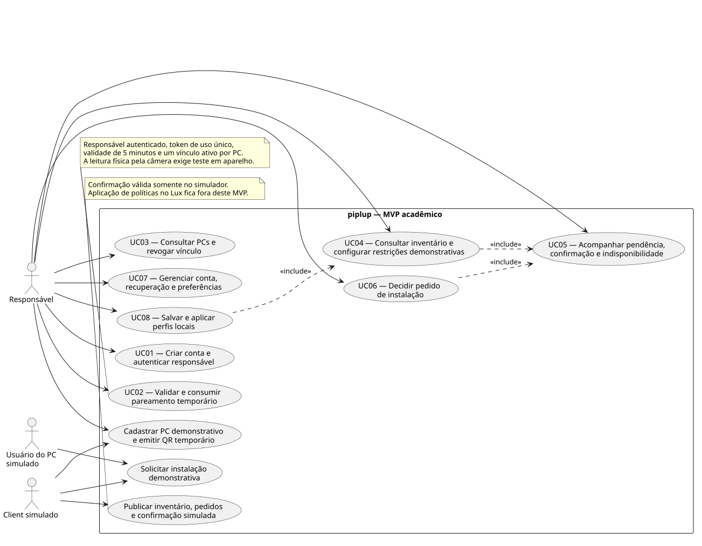
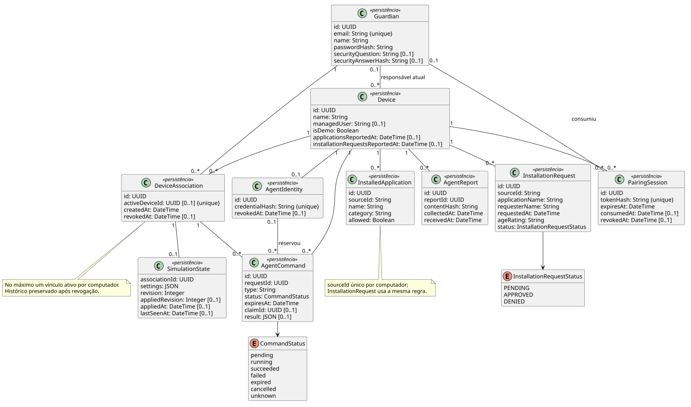
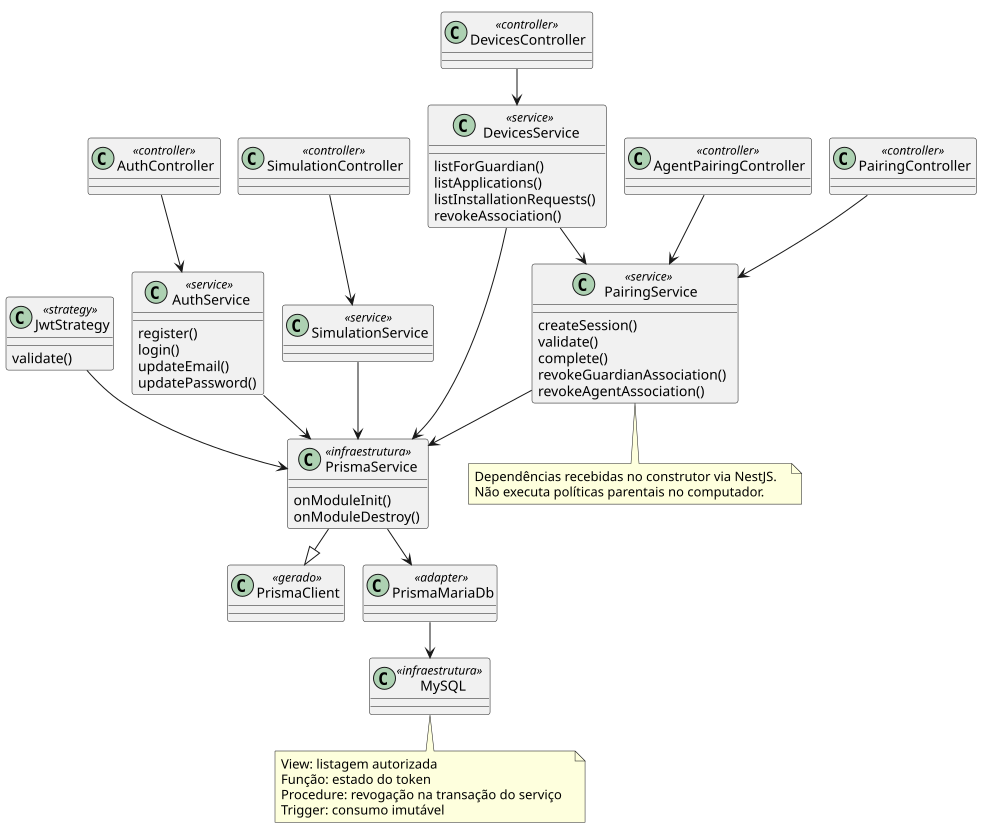

# Engenharia de Software III

## Cenário e limite da entrega

Entrega prevista para **23/11/2026**, com escopo confirmado: aplicativo mobile e client simulado, integrados à API e ao MySQL. O responsável acompanha computadores, altera configurações demonstrativas e decide pedidos de instalação. O client confirma somente sua simulação; não aplica políticas no Lux. O [Produto](product.md) define os atores e limites gerais; a [Arquitetura](architecture.md) distingue integração existente e futura.

## Rastreabilidade dos requisitos da disciplina

| Requisito | Artefato e evidência |
| --- | --- |
| Modelagem orientada a objetos | Diagramas de domínio e classes da aplicação abaixo, derivados do schema Prisma e das classes NestJS |
| Backlog | Histórias priorizadas, critérios de aceite e estado nesta página |
| Casos de uso | Diagrama UML e especificações resumidas abaixo |
| Arquitetura | [Componentes, contratos e fronteiras](architecture.md#componentes-e-responsabilidades) |
| Aplicação de testes | Unitários, HTTP, integração MySQL e cenários Cypress em `e2e/`; instruções em [Testes](testing.md) |
| Padrões de projeto | Adapter e Strategy identificados no código, além de injeção de dependências |
| Protótipo funcional | Rotas Expo em `mobile/src/app`, features integradas à API e [client demonstrativo](simulated-client.md); o [protótipo visual](design.md) é uma referência separada |
| Metodologia ágil | Backlog e proposta de fluxo incremental abaixo; execução de cerimônias e participação da equipe precisam ser registradas pela equipe |

## Diagramas UML

### Casos de uso



[Fonte PlantUML](diagrams/use-cases.puml). UC02 cobre validação e consumo do pareamento; câmera física não é simulada pelos testes de navegador. O cadastro de PC demonstrativo pertence ao ambiente de desenvolvimento/teste.

| Caso | Pré-condição e resultado esperado | Alternativas relevantes |
| --- | --- | --- |
| UC01 — Conta e autenticação | Criar responsável e autenticar com JWT; sessão permite abrir a Home | Dados inválidos, e-mail duplicado, senha incorreta, sessão expirada e API indisponível |
| UC02 — Pareamento | Responsável autenticado e PC com identidade demonstrativa; validar token, confirmar e criar um vínculo ativo | Token inválido/expirado/reutilizado, PC já vinculado e consumo concorrente; nenhuma falha deve criar vínculo parcial |
| UC03 — Dispositivos e revogação | Consultar somente PCs autorizados; remover vínculo após confirmação | Outro responsável não pode consultar/remover; revogação retira acesso e invalida sessões e comandos não concluídos |
| UC04 — Restrições | Selecionar PC demonstrativo pareado, consultar inventário e enviar configuração versionada | PC real indisponível para esse fluxo, relatório ausente, conflito de revisão e vínculo revogado |
| UC05 — Sincronização | Distinguir configuração enviada, pendente, confirmada pelo client e indisponibilidade | Rede ou client interrompidos não podem produzir confirmação falsa; reconexão permite nova consulta |
| UC06 — Pedido de instalação | Client publica pedido; responsável permite/recusa; client publica resultado | Decisão ainda pendente, pedido já decidido, falha de comunicação e consulta de outro vínculo |
| UC07 — Conta e preferências | Alterar e-mail/senha, configurar recuperação, idioma, tema e horário local | Falhas de autenticação/armazenamento; horário local não representa bloqueio automático |
| UC08 — Perfis | Responsável salva configuração portátil no aparelho e confirma PC de destino antes de aplicar | Perfil duplicado, armazenamento inválido, vínculo/revisão alterados; regras individuais e prazos não são copiados |

### Classes de domínio



[Fonte PlantUML](diagrams/domain-classes.puml). É uma modelagem do domínio persistido em `backend/prisma/schema.prisma`; não representa classes de negócio escritas manualmente nem atribui métodos inexistentes aos modelos gerados. `Guardian` é a conta do responsável na API; a conta gerenciada do sistema operacional é outra identidade.

### Classes da aplicação



[Fonte PlantUML](diagrams/application-classes.puml). Recorte das classes existentes, sem listar todos os módulos. Controllers recebem HTTP, services coordenam regras e transações, Prisma acessa o banco. O mobile usa componentes e hooks funcionais React; não é apresentado como uma hierarquia de classes.

Para regenerar os SVGs com um PlantUML já disponível, execute na raiz:

```bash
java -jar /caminho/plantuml.jar -tsvg docs/diagrams/*.puml
```

## Padrões presentes no código

| Padrão | Onde aparece | Benefício e limite |
| --- | --- | --- |
| Adapter | `PrismaMariaDb`, configurado por `backend/src/prisma/prisma.service.ts` | Adapta o driver MariaDB/MySQL ao contrato de persistência Prisma; implementação fornecida pela biblioteca |
| Strategy | `backend/src/auth/jwt.strategy.ts`, sobre `PassportStrategy(Strategy)` do Passport JWT | Encapsula validação JWT e resolução do responsável; não há mecanismo próprio de troca de estratégias implementado |
| Injeção de dependências | Construtores dos services/controllers e providers dos módulos NestJS | Permite substituir Prisma nos testes unitários/HTTP e mantém dependências explícitas; é um mecanismo arquitetural, distinto dos padrões GoF acima |

Não foram adicionadas classes artificiais só para demonstrar um padrão. A [arquitetura existente](architecture.md) e o diagrama de classes mostram as responsabilidades efetivas.

## Backlog do MVP

“Implementado” indica código existente; aceite final exige o roteiro completo no ambiente da apresentação. IDs US/UC abaixo são desta modelagem e não reinterpretam automaticamente os RF do protótipo.

| ID | História e prioridade | Critério de aceite | Estado / evidência |
| --- | --- | --- | --- |
| US01 | Como responsável, quero criar conta e entrar — alta | Login válido abre Home; credencial inválida é recusada e permite nova tentativa | Implementado; UC01, testes Auth e Cypress |
| US02 | Como responsável, quero parear um PC — alta | Token de 5 minutos é consumido uma vez; concorrência não cria dois vínculos | Implementado na API/mobile; UC02, `pairing.mysql-test.mjs`; câmera pendente de aceite em aparelho |
| US03 | Como responsável, quero ver e remover meus PCs — alta | Listagem isolada por conta; revogação retira acesso e não apaga histórico | Implementado; UC03, testes Devices/Pairing/SQL e Cypress |
| US04 | Como responsável, quero configurar restrições demonstrativas — alta | Navegadores, aplicativos, instalação e idade persistem por PC; aplicação depende da confirmação do client | Implementado; UC04/UC05, testes Simulation e integração do client; Cypress cobre navegadores, instalação e idade |
| US05 | Como responsável, quero decidir pedidos de instalação — alta | Pedido aparece no PC correto; aprovação/recusa é persistida e refletida pelo client | Implementado; UC06, integração do client e Cypress de recusa |
| US06 | Como responsável, quero entender falhas de sincronização — alta | Erro de rede não confirma envio nem encerra sessão por si só | Implementado; UC05, testes mobile e Cypress com falha de rede induzida |
| US07 | Como equipe, queremos demonstrar recursos SQL — alta | Função/view/procedure/trigger instalados por migration, usados pela API ou invariantes e testados em MySQL 8.4 | Implementado nesta alteração; `sql-objects.mysql-test.mjs`; [Banco](database.md#objetos-sql-programáveis) |
| US08 | Como responsável, quero administrar conta e preferências — média | Alterações seguem autenticação e persistência documentadas | Implementado; UC07, testes Auth/mobile; interação nativa pendente de aceite |
| US09 | Como responsável, quero reutilizar perfis locais — média | Perfil isolado por responsável, destino confirmado e revisão respeitada | Implementado; UC08, testes mobile de perfis; validação visual pendente |
| US10 | Como equipe, queremos executar testes reproduzíveis — alta | Ambiente exclusivo `_test`, fixtures próprias e relatório de testes, sem banco de uso diário | Implementado e validado em Docker; [resultados e limites](testing.md#validação-em-09112026) |
| US11 | Como equipe, queremos apresentar modelagem coerente — alta | Conferir diagramas, backlog, padrões, arquitetura e limites com o cenário da disciplina | Artefatos preparados; revisão e aceite da equipe/professor pendentes |
| US12 | Como equipe, queremos uma demonstração confiável — alta | Ensaiar no aparelho/rede reais, incluindo falhas e recuperação, e preparar gravação de reserva | Pendente; [checklist no celular](mobile.md#validação-manual-no-celular) |

## Aplicação incremental da metodologia ágil

O Git registra entregas incrementais, mas isso não comprova adoção histórica de Scrum, cerimônias, estimativas ou papéis. O fluxo abaixo é uma proposta para organizar o fechamento do MVP, sem fabricar evidências anteriores.

- **A fazer:** aceite no aparelho, revisão da modelagem e ensaio da apresentação.
- **Validado tecnicamente:** banco/integração e Cypress, com [execução completa aprovada](testing.md#validação-em-09112026); aceite de produto ainda depende do roteiro no aparelho da equipe.
- **Concluído:** mover somente histórias que atendam aos critérios de aceite, com teste ou evidência anexados.

Para cada história: registrar responsável real, critério de aceite, tarefa pequena, evidência e impedimentos; limitar trabalho simultâneo; revisar o incremento antes de puxar a próxima tarefa. A equipe deve registrar as reuniões que efetivamente realizar e ajustar o backlog após o feedback.

Plano sugerido: **09–12/11**, banco/modelagem e ambiente; **13–17/11**, validação e correções no mobile/client; **18–20/11**, regressão e congelamento funcional; **21–22/11**, ensaio. São datas propostas, não atividades já executadas.

Uma história está pronta quando o fluxo e as falhas relevantes funcionam, lint/typecheck/testes aplicáveis passam, documentação corresponde ao código e a evidência de aceite está registrada. Para câmera, permissões e acessibilidade nativas, o aceite depende de aparelho físico. Controle nativo do Lux, GTK, fila offline e bloqueio automático por prazo permanecem fora do escopo confirmado desta apresentação.
